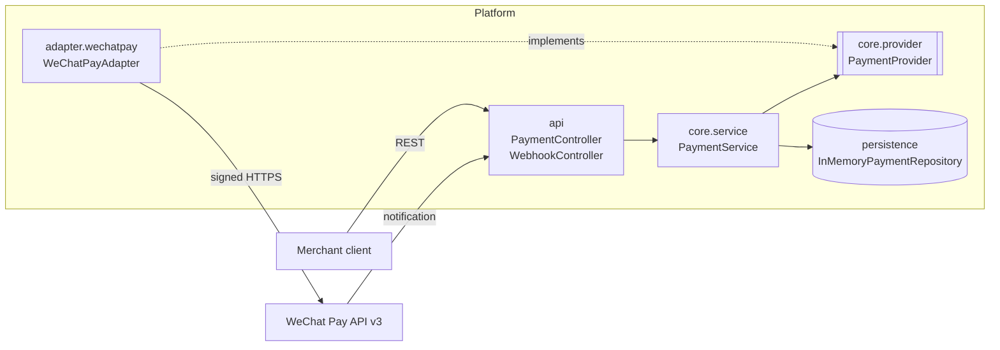
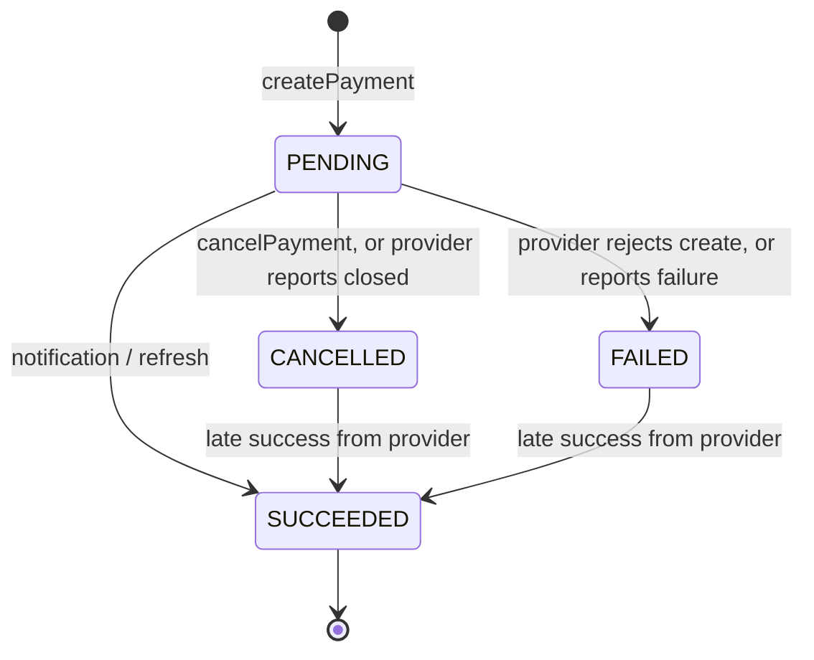

# Architecture

## Layers and the dependency rule



Dependencies point inward, towards `core`:

| Package | May depend on | Must not depend on |
|---|---|---|
| `core.*` | JDK, SLF4J | Spring, `api`, `adapter.*` |
| `api` | `core` | `adapter.*` |
| `adapter.wechatpay` | `core.domain`, `core.provider` | `api`, `core.service` |
| `config` | `core`, `persistence` | `adapter.*` |

`ArchitectureTest` enforces the rules that matter most: nothing outside the adapter references
`com.example.payments.adapter`, and `core` has no Spring imports.

Adapters register themselves: `WeChatPayConfiguration` creates a `WeChatPayAdapter` bean when
`wechatpay.enabled=true`, and `PaymentsConfiguration` collects every `PaymentProvider` bean into a
`PaymentProviderRegistry`. The core never names a provider.

## The provider port

```java
public interface PaymentProvider {
    String name();                                                        // "wechatpay"
    ProviderPaymentSession createPayment(ProviderPaymentRequest request); // -> PaymentAction (QR code, redirect)
    ProviderPaymentUpdate queryPayment(String paymentReference);          // pull status
    void cancelPayment(String paymentReference);                          // close unpaid payment
    Optional<ProviderPaymentUpdate> parseNotification(ProviderNotification notification); // verify + decode
}
```

The contract every adapter follows:

- `paymentReference` is the platform payment id. Send it to the provider as the merchant order reference.
- Map provider statuses to `PaymentStatus` in the adapter. The core never sees provider status codes.
- Authenticate notifications in `parseNotification` (signature, decryption, merchant checks). Throw
  `InvalidNotificationException` if that fails. Return `Optional.empty()` for valid notifications
  that don't affect payment status (e.g. refund events).
- Report provider failures as `ProviderException` (or a subclass) with the provider's error code.
- Return `ProviderPaymentUpdate.amount` when the provider reports it. The core rejects mismatches.

## Payment lifecycle



- Updates that repeat the current status are ignored, so duplicate notifications are harmless.
- Updates that are not allowed (e.g. `SUCCEEDED` → `CANCELLED`) are logged and ignored, not rejected,
  so the provider does not keep retrying them.
- `SUCCEEDED` is terminal. The provider is the source of truth for captured money, so a late success
  overrides a local cancellation or failure.

## Adding a provider (e.g. Alipay)

1. Create `adapter/alipay/AlipayAdapter implements PaymentProvider` with `name()` = `"alipay"`.
2. Put all Alipay concerns inside that package: auth/signing, payload models, status mapping,
   notification verification.
3. Add `AlipayConfiguration` that registers the adapter bean, conditional on `alipay.enabled`.
4. Configure Alipay's notify URL as `https://<host>/api/webhooks/alipay`.
5. Clients send `"provider": "alipay"`.

No changes are needed in `api`, `core`, `persistence`, or `config`. If a provider needs a new kind of
customer action (e.g. an SDK payload for an app), add a `PaymentAction.Type`. That is the only expected
change to the core model.
