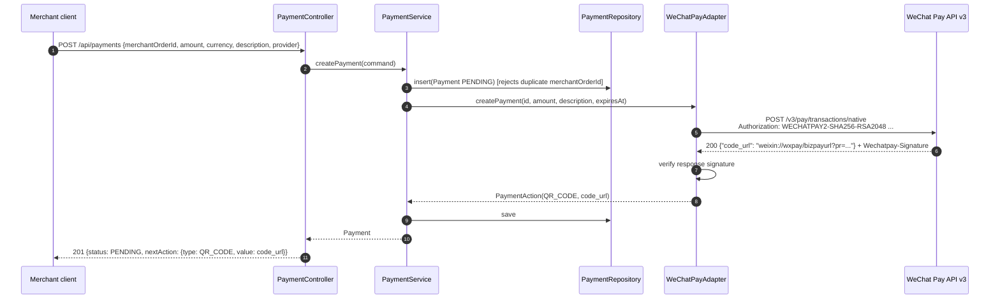
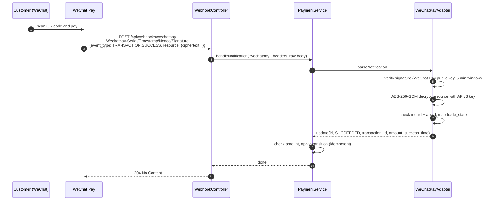
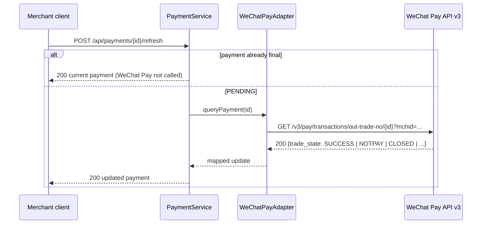
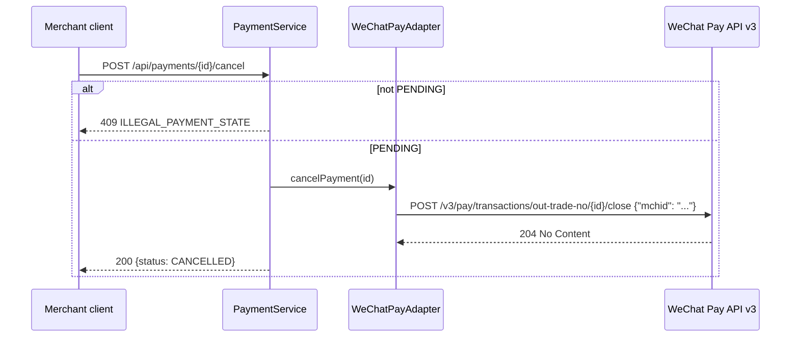

# Payment flows

All flows use WeChat Pay Native payments. `id` is the platform payment id, sent to WeChat Pay as
`out_trade_no`.

## 1. Create payment

The payment is stored **before** WeChat Pay is called, so a fast notification can always find it.

## 2. Customer pays, WeChat Pay notifies

WeChat Pay retries until it gets a 2xx. Repeated notifications return 204 and change nothing.
Notifications that fail verification get `400 {"code":"INVALID_NOTIFICATION"}` and the payment is
not changed.

## 3. Refresh (notification late or missing)

## 4. Cancel unpaid payment

If the customer paid just before the close, WeChat Pay's success notification still moves the
payment to `SUCCEEDED` (see the state machine in [architecture.md](architecture.md#payment-lifecycle)).

## 5. Failures

| Situation | Result |
|---|---|
| Invalid request (amount ≤ 0, bad currency, missing fields) | `400 VALIDATION_FAILED`, WeChat Pay not called |
| Unknown `provider` | `400 UNKNOWN_PROVIDER` |
| Same `merchantOrderId` twice | `409 DUPLICATE_PAYMENT` |
| WeChat Pay returns an error on create (e.g. `PARAM_ERROR`, `NO_AUTH`) | Payment saved as `FAILED`, `502` with the WeChat Pay `code` |
| WeChat Pay response signature missing or invalid | `502 SECURITY_ERROR` |
| Network error or timeout calling WeChat Pay | `502 NETWORK_ERROR` |
| Notification with a bad signature, a stale timestamp, or the wrong key | `400 INVALID_NOTIFICATION`, payment unchanged |
| Notification amount differs from the payment | `422 AMOUNT_MISMATCH`, logged as an error, payment unchanged |

Every row is covered by a test in `PaymentServiceTest`, `WeChatPayAdapterTest`, or
`PaymentFlowIntegrationTest`.
